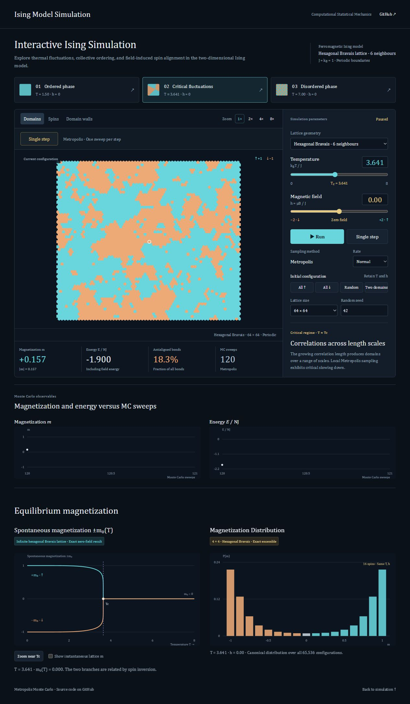

# Ising Model Simulation

An interactive simulation of the two-dimensional ferromagnetic Ising model on **hexagonal Bravais** and **square** lattices. Explore how temperature and magnetic field affect spin configurations, magnetization, and equilibrium fluctuations using local Metropolis Monte Carlo sampling.

**[Open the interactive simulation](https://Madokafriends.github.io/MonteCarlo-simulation-for-2d-hexagonal-lattice/)** · [Physics and numerical methods](docs/PHYSICS.md) · [Contributing](CONTRIBUTING.md)

## Features

- **Two geometries:** six-neighbour hexagonal Bravais and four-neighbour square lattices, with periodic boundaries.
- **Shared temperature and magnetic-field controls:** update the simulation parameters and both equilibrium figures together.
- **Three representations:** magnetic domains, shaded spin glyphs, and domain walls, with zoom and pan.
- **Pause and single-step inspection:** a left-to-right replay reveals the net spin changes from a completed Metropolis sweep.
- **Live observables:** magnetization, energy per spin, antialigned-bond fraction, and trajectories versus Monte Carlo sweeps.
- **Exact equilibrium references:** infinite-lattice zero-field spontaneous magnetization and the full magnetization distribution of a periodic 4 × 4 system.
- **Reproducible configurations:** explicit seed, sizes from 32 × 32 to 256 × 256, and ordered, random, or two-domain initial states.

The application uses HTML, CSS, and JavaScript with Canvas rendering. It runs locally without installation, a build step, external assets, or a backend.

## Run locally

Clone the repository, then open **demo/index.html** in a modern browser:

    git clone https://github.com/Madokafriends/MonteCarlo-simulation-for-2d-hexagonal-lattice.git
    cd MonteCarlo-simulation-for-2d-hexagonal-lattice

Alternatively, serve the repository with Python:

    python -m http.server 8000

Visit **http://localhost:8000/demo/**.

## Using the simulation

1. Choose **Hexagonal Bravais** or **Square** under *Simulation parameters*.
2. Select an ordered, critical, or disordered preset, or adjust temperature and field directly.
3. Run continuously or advance one sweep. The *Spins* view replays the completed update from left to right.
4. Compare the instantaneous configuration and trajectories with the equilibrium references below.

Switching geometry preserves the spins, temperature, field, and random-generator state, recomputes the energy, and starts a new paused trajectory. The critical-temperature marker and equilibrium references follow the selected geometry.

The replay visualizes a completed update. Metropolis proposals are made at randomly selected sites; the display order does not change the sampler. Monte Carlo sweeps are an algorithmic measure, not calibrated physical time.

## Physical model

$$
\frac{\mathcal H}{J}=-\sum_{\langle i,j\rangle}s_i s_j-h\sum_i s_i,\qquad s_i\in\{-1,+1\}.
$$

Each bond is counted once. The interface uses reduced units $J=k_B=1$ and $h=\mu B/J$.

| Geometry | Nearest neighbours | Exact zero-field critical temperature $k_BT_c/J$ |
| --- | ---: | ---: |
| Hexagonal Bravais | 6 | $4/\ln3\approx3.6409569$ |
| Square | 4 | $2/\ln(1+\sqrt2)\approx2.2691853$ |

The curves $\pm m_0(T)$ describe infinite-lattice spontaneous magnetization at **zero field**. They remain labelled as a zero-field reference when the simulation uses a finite field. The distribution panel is an **exact 16-spin canonical ensemble**: all 65,536 configurations are enumerated at the selected temperature and field. It is not a histogram sampled from the larger live lattice.

Finite systems have no thermodynamic singularity, and a finite zero-field ensemble has zero signed mean magnetization by symmetry. Live configurations may be far from equilibrium, especially near the critical point. See the [physics notes](docs/PHYSICS.md) for formulas, conventions, and limitations.

## Python numerical companion

The Python program provides seeded, zero-field Metropolis sampling on the **hexagonal Bravais lattice**. The browser implementation additionally supports square geometry and finite magnetic fields.

    python -m pip install -r requirements.txt
    python main.py --size 16 --temperatures 1.5 3.2 3.64 4.2 6 --burn-in 300 --samples 300 --spacing 5 --seed 42

Results are written to **output/equilibrium.csv**: temperature, energy per spin, mean absolute magnetization per spin, specific heat per spin, and susceptibility per spin. Susceptibility uses **signed** magnetization fluctuations. Browser and Python random generators differ, so equal seeds do not imply identical trajectories.

Files in **gif_v/** and **monte_carlo_results.png** are historical outputs from an earlier implementation. They are retained for provenance and are not validated results of the current model.

## Verification

Run the JavaScript tests with Node.js 22 or later, and the Python tests after installing the requirements:

    node --test tests/*.test.cjs
    python -B -m unittest discover -s tests -p "test_*.py" -v

No Node packages are required. Checks include reciprocal periodic neighbours, local versus total energy changes, seeded sampling, exact enumeration against an independent calculation, equilibrium moments, both critical points and magnetization curves, and display replay that preserves the physical state. GitHub Actions runs verification on pushes and pull requests; successful main-branch runs publish the static demonstration.

## Repository structure

    demo/                  Static application and numerical JavaScript modules
    Lattice.py             Hexagonal Bravais model (historical HexLattice API)
    Particle.py            Binary spin representation
    main.py                Seeded equilibrium sampling and CSV output
    tests/                 JavaScript and Python numerical tests
    docs/PHYSICS.md         Physical interpretation and numerical methods
    .github/workflows/     Verification and static-site deployment

## Acknowledgments

Project direction and maintenance: [Madokafriends](https://github.com/Madokafriends).

Implementation, visualization, documentation, and numerical checks were developed with assistance from **OpenAI Codex**, an AI coding assistant.

Visual and interaction references include [ScienceClic's *What is Spin? A Geometric explanation*](https://www.youtube.com/watch?v=pYeRS5a3HbE) and [Daniel V. Schroeder's Ising Model Demo](https://physics.weber.edu/schroeder/software/demos/isingmodel.html). The Canvas graphics and application code were implemented independently; no video assets were copied.

## References

- [V. Matveev and R. Shrock, J. Phys. A 29 (1996), Eq. 4.2](https://web.njit.edu/~matveev/documents/Matveev_Shrock_tri-hc_JPA_1996.pdf): spontaneous magnetization of the hexagonal Bravais lattice.
- [C. N. Yang, Phys. Rev. 85, 808 (1952)](https://journals.aps.org/pr/abstract/10.1103/PhysRev.85.808): exact square-lattice spontaneous magnetization.
- [David Tong, Statistical Physics, §5.3.4](https://www.damtp.cam.ac.uk/user/tong/statphys/statmechhtml/S5.html): square-lattice critical point.
- [David Tong, Statistical Field Theory, From Spins to Fields](https://www.damtp.cam.ac.uk/user/tong/sft/sfthtml/S1.html): symmetry breaking, thermodynamic limits, and external fields.
